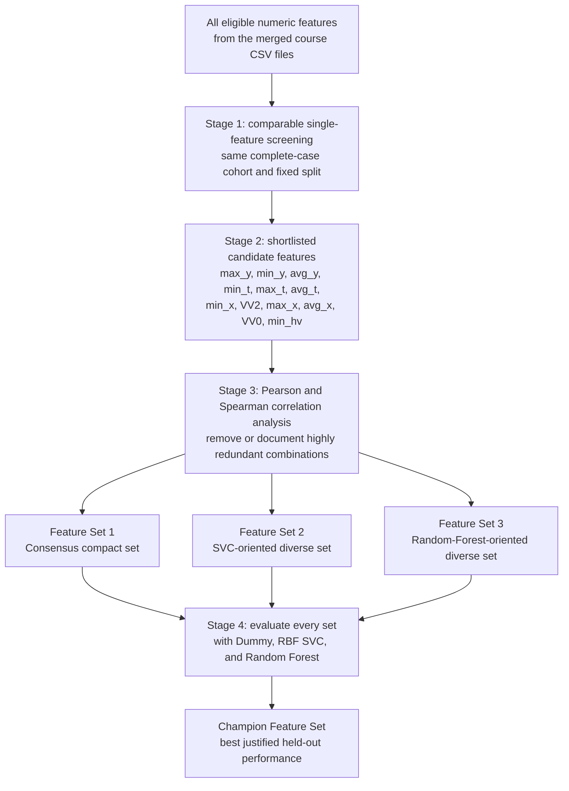

# Feature-Set Evaluation Plan

## Purpose

This document records the planned transition from single-feature screening to feature-set evaluation. It is a guide for the next two workflow stages; it does **not** claim that a winning feature set has already been identified.

The stage-2 shortlist contains these 12 candidate features:

`max_y`, `min_y`, `avg_y`, `min_t`, `max_t`, `avg_t`, `min_x`, `VV2`, `max_x`, `avg_x`, `VV0`, and `min_hv`.

They were selected from the stage-1 single-feature results using the existing fixed held-out split and an auditable combined ranking. They are candidates for correlation analysis, not final features.

## Planned parameter matrix

All feature sets will be evaluated with the same models, the same fixed stratified train/test split used for the comparable screening workflow, and the same reported metrics. This makes comparisons between columns meaningful.

| Selected model (rows) | Feature Set 1: Consensus compact set | Feature Set 2: SVC-oriented diverse set | Feature Set 3: Random-Forest-oriented diverse set |
|---|---|---|---|
| DummyClassifier | Majority-class baseline; it deliberately ignores the feature values. | Majority-class baseline; it deliberately ignores the feature values. | Majority-class baseline; it deliberately ignores the feature values. |
| RBF SVC | `StandardScaler` followed by `SVC(kernel="rbf", C=1.0, gamma="scale", class_weight="balanced")` | Same model and parameters. | Same model and parameters. |
| Random Forest | `RandomForestClassifier(n_estimators=200, random_state=42, class_weight="balanced")` | Same model and parameters. | Same model and parameters. |
| Training/test partition | Reuse the fixed stratified 80/20 partition. | Reuse the same partition. | Reuse the same partition. |
| Primary comparison metric | Macro F1. | Macro F1. | Macro F1. |
| Secondary reported metrics | Accuracy, macro precision, and macro recall. | Accuracy, macro precision, and macro recall. | Accuracy, macro precision, and macro recall. |

The entries in the three feature-set columns describe an evaluation design, not already-computed results. The model hyperparameters are intentionally held constant: the question is whether the **feature set** improves the result, not whether a newly tuned model can improve it.

## Why these three models are used

### DummyClassifier: an honest minimum reference

The `DummyClassifier` always predicts the most frequent training class. It does not learn from any mouse-dynamics feature. Its role is to show the performance expected when feature information is ignored; it is a baseline, never a feature-ranking model.

### RBF SVC: a scaled non-linear classifier

The radial-basis-function support-vector classifier can capture non-linear boundaries between users. `StandardScaler` is fitted on the training portion only, then applied to the held-out portion through the same pipeline. This is necessary because SVC is sensitive to measurement scale. `class_weight="balanced"` reduces the tendency to favour classes with more samples.

### Random Forest: a complementary tree ensemble

The random forest combines 200 decision trees and can model non-linear thresholds and feature interactions without requiring feature scaling. It also uses `class_weight="balanced"` and a fixed `random_state=42` for repeatability. It complements the SVC because agreement between two differently structured models is stronger evidence than a result from one model alone.

## Meaning and construction strategy of the feature sets

The exact membership of the three sets will be produced only after Pearson and Spearman correlations are calculated from the real CSV data in Google Colab. Raw course data will remain in Colab and will not be committed to the repository.

| Feature set | Intended meaning | Construction strategy |
|---|---|---|
| Feature Set 1 — Consensus compact set | A short, balanced group of features that both real models consider useful. | Start with features that have strong combined SVC/Random-Forest ranks. Add features greedily only when they are not highly correlated with features already selected. |
| Feature Set 2 — SVC-oriented diverse set | A group designed around information that is especially useful to the RBF SVC. | Start from the highest SVC-ranked candidates, notably the time-summary candidates where supported by the results. Add low-correlation complementary features rather than near-duplicates. |
| Feature Set 3 — Random-Forest-oriented diverse set | A group designed around information that is especially useful to the random forest. | Start from the highest Random-Forest-ranked candidates, notably strong position and velocity candidates where supported by the results. Add low-correlation complementary features. |

For all three sets, a high absolute Pearson or Spearman correlation indicates that two features may carry substantially overlapping information. The correlation notebook will therefore record every pairwise relationship, state its threshold explicitly, and preserve omitted-feature reasons. It will not silently remove features.

Several shortlisted variables are absolute position or time summaries (for example, `max_y`, `avg_y`, or `avg_t`). They may reflect recording conditions rather than user behaviour. They will be visibly flagged in the correlation and feature-set outputs, so that results using them are treated as provisional and can be compared with a restricted-pool follow-up if required.

## Metrics and why they are used

**Macro F1 is the primary metric.** It calculates F1 separately for every class and then gives every class equal weight. This is appropriate here because a classifier should not appear strong merely by performing well on classes with more observations.

**Accuracy is a secondary metric.** It gives the overall fraction of correct predictions. It is easy to interpret but can hide weak performance for smaller classes, so it cannot be the only decision rule.

**Macro precision and macro recall are secondary diagnostic metrics.** Macro precision describes how reliable the predicted classes are across classes; macro recall describes how completely the classifier finds each class. Together with Macro F1, they help identify whether a feature set improves one aspect at the cost of another.

The final comparison will also report performance against the DummyClassifier and preserve the fixed split fingerprint. Results will be interpreted as held-out comparisons on this dataset, not as proof of generalisation to new sessions, devices, or participants.

## Feature-selection funnel

The **Champion Feature Set** is intentionally a placeholder. It will be named only after the three candidate sets have been evaluated transparently under the matrix above.
