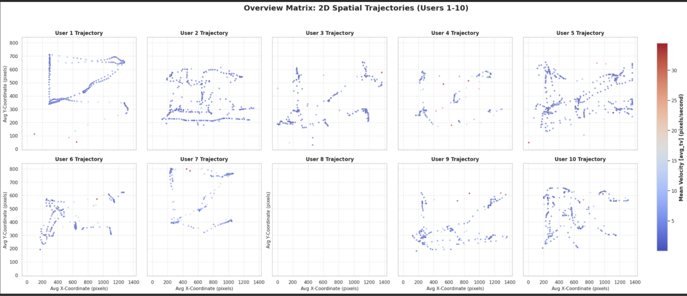
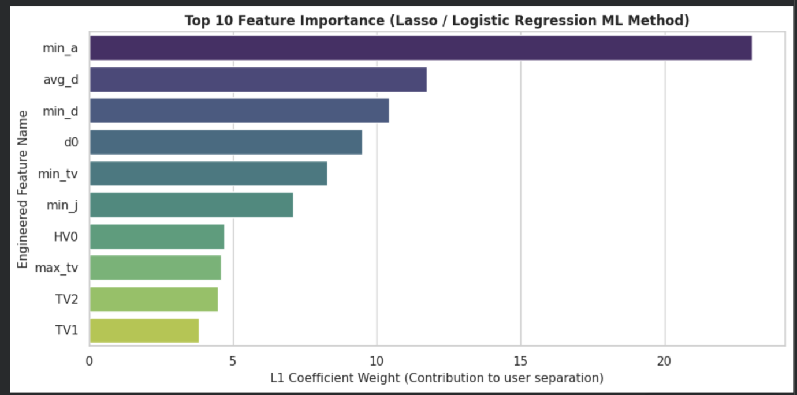
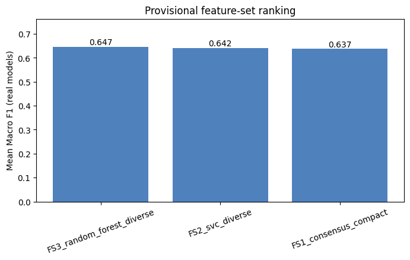
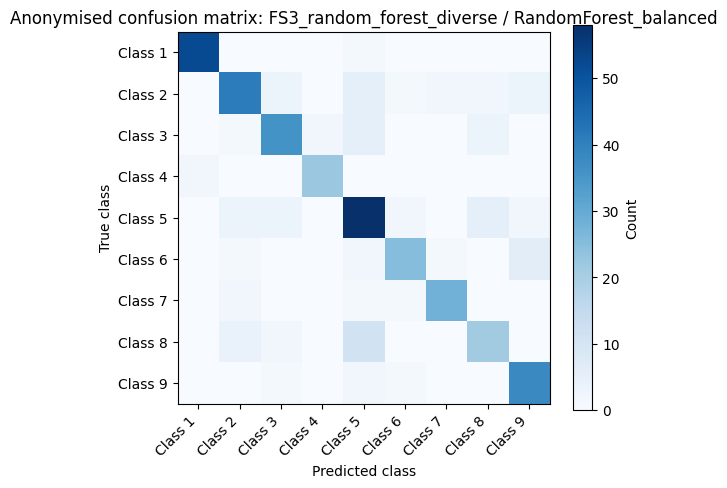

# Group 2 Team Design Portfolio Report

## Project

**Mouse Dynamics Feature Selection and Evaluation for Online Assessment Integrity**

**Team:** Shah Htet Naing and Ziyu Cao  
**Shared portfolio:** [FigJam board](https://www.figma.com/board/PnhLgDNKtcL2Ih17nIdfEO/ICT-2026-TR3-Group2)  
**Version-controlled workflow:** [GitHub repository](https://github.com/ZiyuCao421/26-CP5046-SIN-CAM-TR3-ICT-Project-1-Analysis-and-Design)

This report follows the Group 2 portfolio structure: team information, developer workstreams and prototypes, then a joint synthesis. It distinguishes exploratory work from comparable evaluation. The project investigates multi-class mouse-dynamics identification; it does not claim a deployed authentication or fraud-detection system.

---

# Section 1 Brief Team Information

## Dev 1 Shah Htet Naing

**Scrum role:** Developer and Scrum facilitator  
**Primary workstream:** data understanding, exploratory visualisation, behavioural-feature engineering, and early selection-method comparison in Google Colab.

Shah established the upstream technical workflow needed before model comparison: Drive mounting and path checking, loading and combining raw course CSV files, attaching labels, checking duplicate and missing values, creating feature tables, normalising data, and preparing train/test inputs. His Colab prototype also makes the mouse data understandable through user-distribution charts, 2D trajectory matrices, interactive 3D trajectory views, feature distributions, correlation heatmaps, and train/test composition plots.

Shah then explored three complementary feature-selection perspectives: filter ranking with SelectKBest/ANOVA, embedded Random Forest importance, and L1-regularised Logistic Regression (Lasso). This work supplied a practical interpretation of spatial, velocity, acceleration, jerk, displacement, and angular signals, and identified the need to control redundancy and leakage before a final comparison.

**Key contribution boundary:** Shah's selection-method outputs are exploratory candidate evidence. They are not treated as directly comparable champion feature sets unless evaluated under the shared cohort, split, models, and metric defined in the V3 protocol.

## Dev 2 Ziyu Cao

**Scrum role:** Product Owner and Developer  
**Primary workstream:** auditable V3 screening, visual analysis, correlation-controlled feature-set definition, reproducible evaluation, and reporting in Google Colab and GitHub.

Ziyu converted the broad feature-engineering problem into a four-stage, configuration-driven workflow. Stage 1 screens every eligible numeric feature; Stage 2 saves results and produces a transparent shortlist; Stage 3 calculates Pearson and Spearman correlations and defines low-redundancy feature sets; Stage 4 evaluates every set with unchanged models and records the provisional winner. The notebooks are designed for reuse: changing configuration and input paths permits a new feature screen without rebuilding the methodology.

The V3 workflow preserves aggregate metrics, manifests, figures, reports, configuration files, and limitations in GitHub while keeping raw course CSV data out of the repository. It uses a single complete-case cohort of 2,002 rows and nine classes, a fixed stratified 80/20 split (1,601 training / 401 held out), and a recorded split fingerprint. This establishes a stable comparison contract rather than changing data or parameters between feature sets.

## Shared Assumptions and Uncertainty

The team assumes that movement-derived summaries can provide useful evidence for exploratory multi-class user identification. The team does not assume that a segment-level random split proves real-world authentication. Device type, screen geometry, mouse sensitivity, task context, recording session, and absolute coordinate/time summaries may affect results. A flag should therefore support human review, not produce an automatic assessment penalty.

---

# Section 2 Shared Project Folder and Developer Workstreams

## Shared Project Locations

- **FigJam:** team charter, user stories, teacher Q&A, prototype presentation, Kanban evidence, and V3 visual summaries.
- **Shah's Google Colab:** raw-data preparation, EDA, behavioural feature engineering, and selection-method exploration.
- **Ziyu's GitHub V3:** four Colab notebooks, configuration, aggregate outputs, figures, result reports, and reproducibility record.

## Dev 1 Shah User Stories and Prototype Evidence

### User Story 1 Data Preparation and Trajectory Exploration

**As a data engineer, I want cleaned and labelled mouse-movement data with understandable trajectory views, so that the team can verify the input before modelling.**

**Prototype evidence:** Drive/path checking; raw CSV loading and merging; label creation; duplicate and missing-value checks; user-distribution chart; 2D trajectory matrix; interactive 3D trajectory visualisation; feature histograms; correlation heatmap; and train/test plots.



*Figure 1. Shah's Colab trajectory matrix. This is upstream EDA evidence: it checks the structure and visual plausibility of the mouse paths before feature-set comparison.*

**Sprint review:** This work established the data contract for downstream experiments. It showed why raw coordinates, timestamps, labels, and bookkeeping columns must be handled explicitly and why visual inspection is necessary before interpreting a model score.

**Retrospective and next action:** The main risk is that raw coordinate or time fields may describe recording conditions rather than person-specific behaviour. These fields should be flagged or excluded from a restricted follow-up comparison rather than silently accepted as biometric evidence.

### User Story 2 Statistical Feature Ranking

**As a behavioural-biometrics researcher, I want filter-based ranking of candidate features, so that statistically distinctive movement signals can be inspected before modelling.**

**Prototype evidence:** SelectKBest/ANOVA ranking and explanatory Colab cells discussing velocity, acceleration, jerk, displacement, and angular movement.

**Sprint review:** The filter method provides a readable univariate ranking, which is useful for explaining why a feature becomes a candidate. It cannot by itself prove that a collection of individually strong features forms a non-redundant set.

**Retrospective and next action:** Preserve the rankings as candidate evidence, then apply correlation checks and the common evaluation matrix before calling a set better than another set.

### User Story 3 Embedded and Regularised Selection Methods

**As a model-validation reviewer, I want Random Forest importance and L1-regularised selection to be compared with filter ranking, so that the team can identify robust candidates and reduce redundant signals.**

**Prototype evidence:** Random Forest importance, SelectFromModel-style embedded selection, Lasso/Logistic Regression coefficients, and explanations of their different assumptions.



*Figure 2. Shah's Colab Lasso/Logistic Regression ranking. The plot provides model-based candidate evidence; it does not by itself establish a final comparable champion set.*

**Sprint review:** Tree-based and regularised methods bring complementary evidence: Random Forest can identify non-linear interactions, while L1 regularisation can shrink weaker linear signals. The result is a richer candidate pool, not an automatic final answer.

**Retrospective and next action:** Ensure every selection method is fitted on training data only and separate method exploration from the later, controlled feature-set comparison.

## Dev 2 Ziyu User Stories and Prototype Evidence

### User Story 1 Complete Single-Feature Screening

**As an assessment product owner, I want every eligible feature tested under the same conditions, so that feature choices are evidence-based rather than selected by preference.**

**Prototype evidence:** `01_all_feature_screening.ipynb`, screening configuration, feature inventory, run metadata, single-feature metrics, and failure/exclusion audit.

**Sprint review:** Stage 1 screened 57 eligible features from a 2,002-row complete-case cohort. Thirteen non-feature, ID, raw-coordinate, raw-time, or bookkeeping columns were excluded. All 171 model-feature evaluations completed without failure.

**Retrospective and next action:** A large screen is only useful when the split and cohort remain stable. Stage 2 therefore used the recorded metrics to produce a deterministic candidate shortlist rather than rerunning the data with changing assumptions.

### User Story 2 Transparent Shortlisting and Correlation-Controlled Feature Sets

**As a machine-learning evaluator, I want shortlisted features and their relationships visualised, so that near-duplicate information is not hidden inside a feature set.**

**Prototype evidence:** `02_single_feature_visualisation.ipynb`, top-feature plots, distribution and agreement plots, `03_feature_correlation_and_set_definition.ipynb`, correlation output, and feature-set definitions.

**Sprint review:** Stage 2 selected 12 candidate features from existing held-out metrics. Stage 3 checked all 66 upper-triangle feature pairs with both Pearson and Spearman measures, found nine pairs at the stated redundancy threshold of 0.85, and created three low-redundancy six-feature sets.

**Retrospective and next action:** Correlation removes only one source of redundancy. The three sets must still be run through the same models because a low-correlation combination is not automatically a high-performing combination.

### User Story 3 Fair Feature-Set Evaluation and Reporting

**As an assessment product owner, I want every candidate set evaluated with fixed models and a fixed held-out split, so that the current selection decision is fair and reviewable.**

**Prototype evidence:** `04_feature_set_evaluation_and_visualisation.ipynb`, parameter matrix, macro-F1 comparisons, results summaries, and `04_v3_complete_report.md`.



*Figure 3. Ziyu's GitHub V3 ranking of three correlation-controlled feature sets by the mean Macro F1 of RBF SVC and Random Forest.*



*Figure 4. Ziyu's GitHub V3 FS3 result for the balanced Random Forest, shown against the majority-class baseline.*

**Sprint review:** The three sets were evaluated with a majority-class DummyClassifier, training-only scaled RBF SVC, and 200-tree balanced Random Forest. Macro F1 was the primary measure; accuracy, macro precision, and macro recall were kept as secondary diagnostics.

**Result:** `FS3_random_forest_diverse` is the provisional held-out winner. Its members are `min_y`, `VV0`, `VV2`, `min_hv`, `min_t`, and `min_x`. It achieved Macro F1 of 0.487 with RBF SVC and 0.807 with Random Forest, giving a two-real-model mean of 0.647.

**Retrospective and next action:** FS3 is only slightly ahead of FS2 (0.647 versus 0.642 mean Macro F1). The decision should be recorded as provisional until repeated splits, group-aware validation, and independent data have been tested.

---

# Section 3 Synthesis of Prototype Outputs Optimal Feature-Set Selection and Scrum Sprint Reflection

## 3.1 Summary of Prototype Outputs Across Developer Workflows

| Workstream | Shah Colab contribution | Ziyu GitHub V3 contribution | Joint value |
|---|---|---|---|
| Data understanding | Data paths, CSV loading, labels, cleaning checks, trajectory and distribution visualisations | Feature-inventory and exclusion audit on the comparison cohort | A documented input contract and visible data-quality risks |
| Feature engineering | Spatial, temporal, velocity, acceleration, jerk, displacement, and angular candidates; SelectKBest, Random Forest, and Lasso exploration | Complete screen of 57 eligible features, deterministic 12-feature shortlist | Candidate evidence is broad before final selection is narrow |
| Redundancy control | Motivation for avoiding correlated or leakage-prone signals | Pearson/Spearman analysis of 66 pairs; nine redundant pairs documented | Feature sets are not constructed by silently stacking similar summaries |
| Model evaluation | Explains complementary selection perspectives and visualises intermediate evidence | Fixed cohort, fixed split, Dummy/SVC/Random Forest comparison, saved metrics and reports | Final decision is reproducible and constrained by a shared protocol |
| Communication | Colab charts and technical explanation | GitHub reports, manifests, workflow diagrams, and plain-language results | Findings can be inspected by technical and non-technical project stakeholders |

## 3.2 Comparative Evaluation and Selection of the Current Optimal Feature Set

The team does not treat Shah's exploratory method outputs and Ziyu's V3 sets as two competing, directly comparable final pipelines. Shah's work generates and explains candidate signals and selection approaches. Ziyu's V3 work provides the controlled protocol used for the final feature-set decision. This sequence is intentional: exploration informs comparison, and comparison prevents an attractive exploratory result from being overstated.

### Selected Current Feature Set

**`FS3_random_forest_diverse`**

`min_y`, `VV0`, `VV2`, `min_hv`, `min_t`, `min_x`

| Rank | Feature set | RBF SVC Macro F1 | Random Forest Macro F1 | Mean of real models |
|---:|---|---:|---:|---:|
| 1 | FS3 random forest diverse | 0.487 | 0.807 | 0.647 |
| 2 | FS2 SVC diverse | 0.488 | 0.795 | 0.642 |
| 3 | FS1 consensus compact | 0.484 | 0.790 | 0.637 |

### Justification

FS3 has the strongest average Macro F1 across the two real models on the recorded held-out split. It is not selected merely because the Random Forest score is high: all three sets were tested with the same 2,002-row cohort, the same nine class labels, the same stratified 80/20 split, the same model parameters, and the same primary metric. The DummyClassifier supplies the honest no-feature reference.

The decision remains limited. FS3 and FS2 differ by approximately 0.005 in mean Macro F1, selected position/time summaries can encode session conditions, and every selection step reuses the same held-out split. The correct conclusion is **current provisional champion**, not production-ready identity verification.

## 3.3 Group Collaboration Governed by Scrum Sprint Practice

The team worked as two linked streams rather than duplicate implementations. Shah's stream reduced uncertainty at the data and candidate-feature level. Ziyu's stream converted comparable inputs into an auditable selection and evaluation pipeline. The shared Scrum artefacts in FigJam document the product direction, roles, user stories, teacher Q&A, work process, and prototype outputs.

The practical handoff contract was:

1. **Shah to team:** understood raw mouse-dynamics inputs, cleaning requirements, exploratory visualisations, candidate feature-engineering ideas, and alternative feature-selection methods.
2. **Ziyu to team:** stable screening configuration, fixed-split metrics, correlation-controlled feature-set definitions, final evaluation table, GitHub records, and limitation statement.
3. **Shared review:** no feature set could be selected without a named cohort, split, model configuration, primary metric, saved output, and stated limitation.

## 3.4 Key Takeaways

- Behavioural-mouse data needs both visual inspection and reproducible metric-based evaluation.
- A feature that ranks well alone may be redundant or weak when combined with others.
- A selection-method chart is candidate evidence; it is not itself a fair model comparison.
- Macro F1 is more appropriate than accuracy alone for the multi-class task because every user class receives equal weight.
- GitHub should store notebooks, configurations, aggregate outputs, reports, and figures; raw course data must remain outside the repository.
- A strong held-out result on one split is useful for prioritisation but insufficient for real-world authentication claims.

## 3.5 Preparation for the Combined Feature Set and Model Benchmark Notebook

The next notebook will compare the feature sets produced by both developers without treating different data partitions, model configurations, or post-hoc selection steps as interchangeable. Its purpose is to answer two separate questions:

1. **Feature-set question:** under one documented data contract, which declared feature set supports the strongest held-out Macro F1?
2. **Model question:** for each declared feature set, which fixed model produces the strongest result?

### Candidate-set registry

| Registry name | Owner and provenance | Status in the combined notebook |
|---|---|---|
| `shah_anova_candidate` | Shah Colab filter ranking / SelectKBest | Reconstruct from recorded Colab-selected columns; validate every column before use. |
| `shah_random_forest_candidate` | Shah Colab embedded Random Forest importance | Reconstruct from recorded Colab-selected columns; validate every column before use. |
| `shah_lasso_candidate` | Shah Colab L1-regularised Logistic Regression ranking | Reconstruct from recorded Colab-selected columns; validate every column before use. |
| `FS1_consensus_compact` | Ziyu GitHub V3 | Fixed six-column manifest already documented. |
| `FS2_svc_diverse` | Ziyu GitHub V3 | Fixed six-column manifest already documented. |
| `FS3_random_forest_diverse` | Ziyu GitHub V3 | Fixed six-column manifest already documented. |

The three Shah entries must be saved as explicit feature-name lists, rather than copied from a chart manually. A candidate set is excluded with a clear error if a named column is missing, non-numeric, raw identifier, raw coordinate/time field, or not available after cohort construction.

### Non-negotiable comparison contract

| Contract item | Requirement |
|---|---|
| Raw input | Load the same approved course CSV folder and preserve source labels. Raw data stays in Drive/Colab, not GitHub. |
| Cohort | Build one complete-case cohort across the union of all declared candidate columns. Report its row count and a split fingerprint. |
| Split | Use one stratified 80/20 partition with a fixed `random_state`; no feature set receives its own convenient split. |
| Core models | DummyClassifier, training-only scaled RBF SVC, and balanced Random Forest with fixed documented parameters. |
| Optional extension models | Logistic Regression, KNN, and Gaussian Naive Bayes may be run only as separately labelled sensitivity models, never mixed silently into the core ranking. |
| Primary metric | Macro F1 for each **model + feature-set** combination. |
| Secondary diagnostics | Accuracy, macro precision, macro recall, confusion matrix, class counts, and failure/exclusion audit. |
| Decision rule | Report the best pipeline, the best set within each model, and the mean of the two real core models as a stability summary. Do not use the mean to hide a weak individual model. |

### Leakage and selection safeguards

The combined notebook must distinguish **reproduction** from **clean validation**. Re-running the already selected V3 sets on the V3 split is a reproducibility check, not new independent validation. If Shah's selection procedures are rerun, SelectKBest, Random Forest importance, and Lasso must be fitted on the training partition only. A clean validation phase should regenerate each selection inside training data or use an untouched external/session-aware test set.

### Required notebook outputs

```text
combined_feature_set_manifest.json
combined_input_contract_report.md
combined_metrics.csv
combined_ranked_pipelines.csv
combined_failure_and_exclusion_audit.csv
figures/combined_macro_f1_heatmap.png
figures/combined_model_by_set_bar_chart.png
figures/combined_confusion_matrix_<winner>.png
combined_limitations.md
```

### Reusable configuration skeleton

```python
FEATURE_SET_REGISTRY = {
    "shah_anova_candidate": [...],
    "shah_random_forest_candidate": [...],
    "shah_lasso_candidate": [...],
    "FS1_consensus_compact": ["max_y", "min_t", "min_x", "VV2", "VV0", "min_hv"],
    "FS2_svc_diverse": ["avg_t", "max_y", "min_x", "VV2", "min_hv", "VV0"],
    "FS3_random_forest_diverse": ["min_y", "VV0", "VV2", "min_hv", "min_t", "min_x"],
}

CORE_MODELS = {
    "DummyClassifier": "most_frequent baseline",
    "RBF_SVC": "StandardScaler + balanced RBF SVC",
    "RandomForest": "200-tree balanced Random Forest",
}
```

The `[...]` entries are deliberately not guessed. They must be exported from Shah's executed Colab output or re-derived in the training partition before the combined run.

## 3.6 Future Roadmap and Next Sprint Priorities

1. Export Shah's three candidate feature lists into a named manifest and validate them against the shared schema.
2. Implement the combined notebook using the contract above; save all aggregate results and figures to GitHub.
3. Repeat the comparison across multiple random seeds and report score stability.
4. Use session-aware or group-aware validation if recording/session identifiers are available.
5. Run a restricted comparison excluding absolute position and time summaries to test recording-condition dependence.
6. Define a separate claimed-user verification protocol before using specificity, false-accept, or false-reject language as deployment metrics.
7. Only after a stable baseline is established, evaluate deep-learning or transfer-learning extensions under a separate reproducible protocol.
8. Conduct real stakeholder interviews with students, academic-integrity staff, accessibility advisers, and IT support before designing any operational intervention.

## Repository Evidence

- `V3/notebooks/01_all_feature_screening.ipynb`
- `V3/notebooks/02_single_feature_visualisation_validated.ipynb`
- `V3/notebooks/03_feature_correlation_and_set_definition_fixed.ipynb`
- `V3/notebooks/04_feature_set_evaluation_and_visualisation.ipynb`
- `V3/results/single_feature/README.md`
- `V3/results/feature_sets/README.md`
- `V3/results/summaries/README.md`
- `V3/docs/04_v3_complete_report.md`
